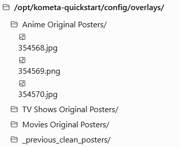

# Background
The purpose of this is to remove the overlays from plex while there are missing original files that Kometa is unable to find resulting in the built-in commands to fail and exit the script with a 502 error pointing to the issue.


# 2 Fold Fix

1. Restore overlays: 
	1. Restore posters only when an existing backup is found under /opt/kometa-quickstart/config/overlays/. 
	2. Skip missing backups, continue processing, and remove Plex's Overlay label only after a successful restoration.

2. Backup Plex posters: After you've updated the artwork in Plex, download the selected posters into the same directory, organized by library and Plex rating key.


## Install and Usage commands

Copy it to:
/opt/kometa-quickstart/config/kometa_overlay_preserve.py

### Fix 1. Restore Original Posters
Step 1 — Preview the overlay cleanup
```bash
/opt/kometa/.venv/bin/python \
  /opt/kometa-quickstart/config/kometa_overlay_preserve.py \
  restore --library "Anime"
```

It will display results such as:
DRY RESTORE     [show:12345] Anime Title <- 12345.jpg
SKIP no backup  [show:354568] Another Anime Title


Nothing changes during the preview.
Step 2 — Restore the available backups
```bash
/opt/kometa/.venv/bin/python \
  /opt/kometa-quickstart/config/kometa_overlay_preserve.py \
  restore --library "Anime" --apply
```

The utility will:
- Restore available clean posters to Plex.
- Skip missing or invalid backups.
- Continue if an individual poster upload fails.
- Remove the Overlay label only after a successful poster upload.
- Preserve all existing backup files, including restored ones.
By default, the utility also handles season posters and episode thumbnails in TV libraries.

### Fix 2. Create a Backup of Original Posters
Step 1 — Update the missing posters in Plex
For items skipped because their backups are missing, select clean artwork manually in Plex. Once the poster is correct, remove that item's Overlay label in Plex.

This is necessary because the script deliberately avoids treating still-labeled posters as clean originals.
Step 2 — Download all updated Plex posters
First preview:
```bash
/opt/kometa/.venv/bin/python \
  /opt/kometa-quickstart/config/kometa_overlay_preserve.py \
  backup --library "Anime" --overwrite
```bash

Then download:
```bash
/opt/kometa/.venv/bin/python \
  /opt/kometa-quickstart/config/kometa_overlay_preserve.py \
  backup --library "Anime" --overwrite --apply
```

--overwrite refreshes existing backup files using the currently selected artwork from Plex. Older backups are archived under _previous_clean_posters before replacement.

The directory will look like this:

<picture>
  
</picture>


The filenames are the Plex rating keys; extensions are determined by the downloaded artwork.
To process all three libraries, repeat --library in the command with each library's exact Plex name.


### Important precautions
Before running Kometa normally again, change remove_overlays: true to false in the affected libraries. Also keep their overlay definitions disabled if you don't want Kometa to start applying overlays again.

Do not run the backup command while unwanted overlays are still present. By default, the script skips items retaining the Overlay label; saving those posters as originals could make future overlay operations permanently incorporate the old graphics.

Finally, the backup mode saves the currently selected artwork from Plex, not every alternative poster in Plex's poster picker. These new files are suitable as a baseline for later Kometa operations, provided the posters were clean when downloaded. 


This workflow gives you the two behaviors you want: a cleanup that continues past missing originals, followed by a fresh backup of the posters you've selected in Plex.